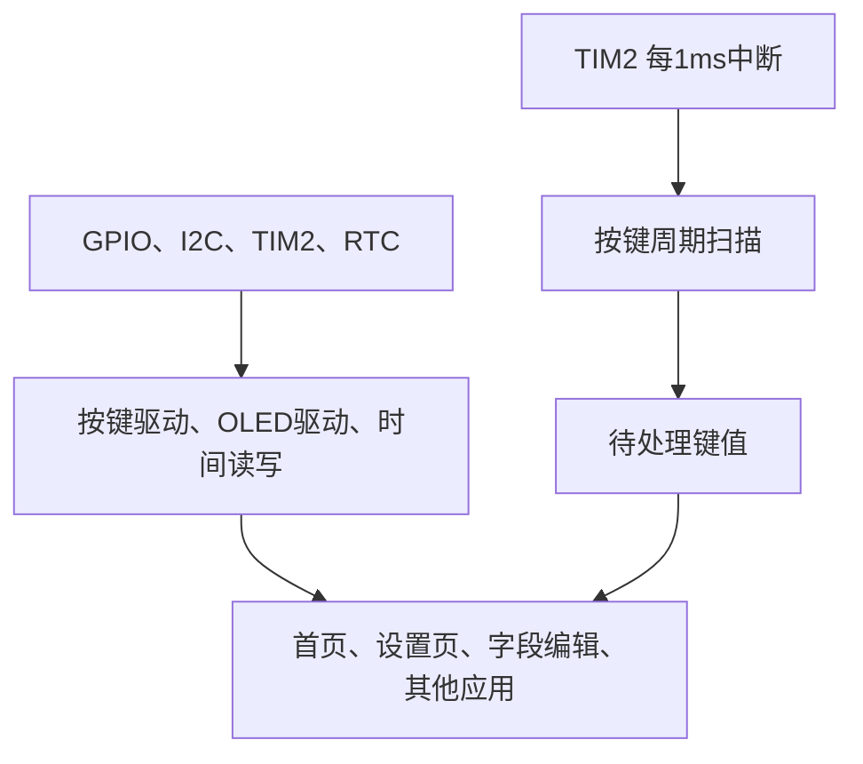

# 01 设计与硬件约定

[返回目录](../README.md) · [下一章：工程与编辑环境](02-environment.md)

## 本章目标

先理解手表为什么拆成多个模块，再开始编码。一个功能从“按键输入”到“屏幕变化”通常经过三层。



硬件层负责收发电平和产生时基；驱动层把这些操作转换为“按键事件”“绘制字符串”等接口；页面层决定当前选项和页面跳转。

## 原作者的页面组织

配套源码用页面函数管理界面：

```text
main 的循环
  └─ 首页函数：循环读取按键、绘制首页
       └─ 按确认键，返回入口编号
  └─ 根据编号调用菜单或设置页
       └─ 子页面执行 return，回到调用者
```

每个页面可以有自己的 `while (1)`。定时器中断独立执行按键扫描，因此页面循环运行时，按键扫描仍能按周期执行。

本教程沿用这个结构。前几章不引入任务调度器或 RTOS，也不把原作者的页面函数重新改造成另一套框架。

## 本教程的硬件约定

| 用途 | 引脚 / 外设 | 本教程约定 |
|---|---|---|
| MCU | STM32F103C8T6 | Cortex-M3 |
| 系统时钟 | HSI | 8 MHz；APB1 分频为1，TIM2 时钟也是8 MHz |
| 按键1 | PB1 | 上拉输入，按下接地 |
| 按键2 | PA6 | 上拉输入，按下接地 |
| 按键3 | PA4 | 上拉输入，按下接地 |
| OLED SCL | PB8 | I2C1 重映射后的时钟引脚 |
| OLED SDA | PB9 | I2C1 重映射后的数据引脚 |
| OLED 画布 | 128×64 | 按实际驱动芯片选择列偏移 |
| OLED 地址 | 7位地址0x3C | 调用 HAL 时传入 `0x3C << 1`；以实物响应为准 |
| 扫描时基 | TIM2 | 1 ms 中断一次 |
| RTC 时钟 | LSE | 本学习工程启用外部32.768 kHz晶振 |
| 调试接口 | PA13 / PA14 | SWD；CubeMX 中选择 Serial Wire |

若接线不同，先统一硬件配置和驱动中的引脚。PC13 灯的有效电平取决于板上 LED 接法，不能仅凭引脚编号判断。

## 原工程与 HAL 学习工程的对应关系

| 原作者接口 / 设置 | 本教程对应内容 |
|---|---|
| 标准库 GPIO 读取 | `HAL_GPIO_ReadPin()` |
| `Key_GetState()` | `KEY_GetValue()`：读取当前按键 |
| `Key_Tick()` | `KEY_Scan()`：周期扫描，产生事件 |
| `Key_GetNum()` | `Key_Event()`：读取并清空事件 |
| `TIM2_IRQHandler()` 内扫描 | HAL 定时器回调内调用 `KEY_Scan()` |
| GPIO 模拟 I2C | 硬件 I2C1，重映射到 PB8/PB9 |
| 原工程72 MHz定时参数 | 按本工程8 MHz重新计算 |
| `MyRTC_Time` 保存完整年份 | `my_time[0]` 保存年份偏移，显示时加2000 |

**借鉴的是组织方式和交互逻辑；底层参数必须依据当前硬件和时钟重新确认。**

## 数据和事件如何流动

当前时间数组定义为：

```c
#define FIX_YEAR 2000
uint8_t my_time[] = {26, 11, 2, 21, 13, 0};
```

| 下标 | 含义 | 示例 |
|---|---|---|
| 0 | 年份偏移 | 26表示2026年 |
| 1 | 月 | 11 |
| 2 | 日 | 2 |
| 3 | 时 | 21 |
| 4 | 分 | 13 |
| 5 | 秒 | 0 |

当前阶段页面直接读取这个 RAM 数组；年份编辑直接修改下标0。它还没有与 RTC 保持同步，首页时间不会自行递增。

按键的路径是：

```text
GPIO电平 → 当前键号 → 20ms间隔采样 → 松手事件 → 页面处理
```

驱动不决定“键1是上一项还是加一年”。首页把键1解释为上一项，年份编辑把键1解释为加一年。

## 后续学习路线

本仓库当前写到年份编辑。之后按原配套资料逐项推进：

| 原教程阶段 | 后续功能 | 核心知识 |
|---|---|---|
| 1-2 | 月、日、时、分、秒编辑 | 各字段范围、闰年和每月天数 |
| 1-2 | RTC读写与上电保留 | BIN/BCD、备份域、初始化标志、日期保存 |
| 1-3 | 滑动菜单 | 选中项、目标坐标、逐步移动 |
| 1-4 | 秒表 | 周期计数、暂停、清零 |
| 1-5 | 手电筒 | 按键与输出状态 |
| 1-6 | MPU6050姿态显示 | I2C采集、角度计算 |
| 1-7 | 小恐龙 | 周期更新、跳跃、碰撞 |
| 1-8 | 动态表情 | 帧数据与播放间隔 |
| 1-9 | 水平仪 | 角度到屏幕坐标的映射 |
| 1-10 | 电量检测和长按关机 | ADC换算、长按状态、电源控制 |

## 验证

进入下一章前，应能回答：

1. 为什么页面函数不用直接读取 GPIO？
2. 子页面中的 `return` 会回到哪里？
3. 为什么原作者的预分频数不能直接复制到8 MHz工程？
4. 为什么修改 `my_time` 不等于修改了 RTC？
