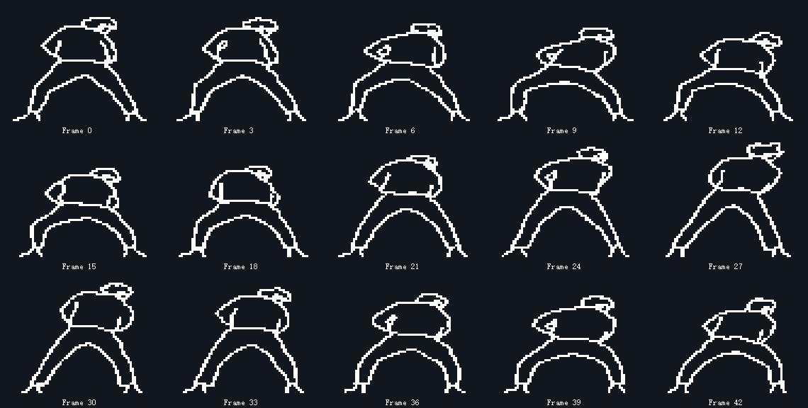

# OLED 经典左右抖肩动画

菜单 `menuFlag == 5` 调用 `KunDance()`，播放经典叉腿屈膝、躯干左右倾斜、肩部随之摆动的抖肩轮廓动画。



[播放 GIF 预览](assets/kun-dance.gif)

- 从菜单第 5 项进入，底部标签为 `KUN DANCE`；按键 3 返回菜单。
- 素材为 72×56 像素、45 帧，每帧解码后 504 字节。原始帧数据共 22680 字节，以帧间异或加零游程方式无损压缩为 7326 字节，再加 92 字节索引；解码复用 504 字节 RAM 缓冲区。
- 屏幕绘制位置为 `(28, 8)`，标题和 `3:OUT` 返回提示都在顶行。
- 第一帧整屏发送，后续只更新动画所在的 72×56 矩形，固定文字不进入清除区域。
- 每帧目标间隔为 60 ms，一轮约 2.7 秒；实际效果仍受总线写屏耗时影响。

修改 `bsp/OLED_Data.h` 的 `OLED_KUN_DANCE_FRAME_MS` 可以调整速度。帧间隔小于实际写屏时间时，不会继续按比例加速。

压缩数据在 `bsp/OLED_Data.c` 的 `Kun_DancePacked` 中。调用 `OLED_GetKunDanceFrame(frame)` 得到纵向 8 点、最低位在上的完整位图，再交给 `OLED_ShowImage()`。返回指针指向复用缓冲区，应先绘制当前帧再请求下一帧；帧号自动取模，也支持从任意帧开始。本次保留了已经调整好的 OLED 扫描时钟配置。

```c
OLED_ShowImage(28, 8, OLED_KUN_DANCE_WIDTH, OLED_KUN_DANCE_HEIGHT,
               OLED_GetKunDanceFrame(frame));
OLED_UpdateArea(28, 8, OLED_KUN_DANCE_WIDTH, OLED_KUN_DANCE_HEIGHT);
```

压缩用于满足当前 Keil 评估版的 32 KB 链接限制，完整保留 45 帧，不丢帧、不缩放。完整工程链接后 Code + RO-data 为 31412 字节。

## 参考与素材来源

- 动画素材：[h0e4a0r1t/Flipper_Zero_iKun_Animation](https://github.com/h0e4a0r1t/Flipper_Zero_iKun_Animation)，作者 README 中的公开 128×64、45 帧轮廓 GIF。保留其动作顺序，将每帧 `(18, 6)` 开始的 72×56 区域无缩放裁取，转换为本项目的纵向字节格式；裁取没有丢弃任何亮像素。素材并非本项目原创绘制。
- [原始参考 GIF](assets/kun-shoulder-source.gif)，源地址：[GitHub README GIF](https://user-images.githubusercontent.com/48357278/225803734-ef84a642-b377-444b-86f8-732b9c3c24ef.gif)。原始帧间隔为 50 ms，项目按 100 kHz I2C 写屏预算调整到目标 60 ms；上方播放预览与项目的 60 ms 一致。
- 动作核对：[汤姆的混乱空间《只因你太美分解教学，5分钟速成资深IKUN》](https://www.bilibili.com/video/BV1oN4y1u723/)。查看了公开预览关键帧，核对背带裤造型、叉腿屈膝和左右倾斜抖肩；未下载完整教学视频，也没有将该视频的画面直接打包到固件中。
