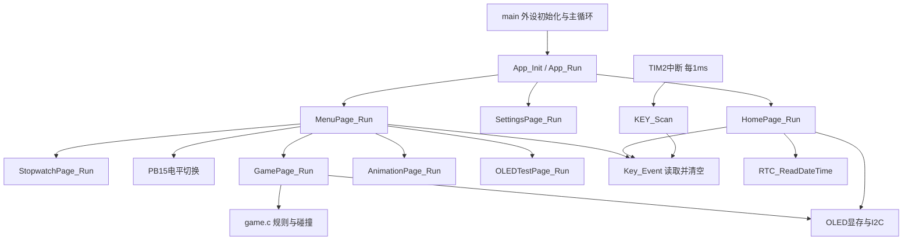

# 00 总架构：先决定每个模块管什么

[模块目录](README.md) · [下一章](01-platform.md)

## 设计思想

把“读电平”“按键事件”“按确认进入游戏”拆开：驱动处理硬件，页面解释事件，应用层选择页面。这样修改菜单时不用重新写I2C，修改接线时不用重新写游戏。



图中只画出部分公共依赖，设置、秒表、动画和测试页也使用按键/OLED。当前页面是阻塞循环结构：进入一个页面后由该页面持续处理输入，`return`返回调用者。TIM2中断仍能运行；这不等于所有页面同时在后台执行。

## 变量与逻辑

| 状态归谁 | 变量 | 为什么放这里 |
|---|---|---|
| 应用 | `my_time[6]` | 首页与设置共享同一缓存，生命周期覆盖页面调用 |
| 按键驱动 | `key_value` | 中断生产、当前页面消费的单槽事件 |
| 首页 | `cliFlag` | 只决定菜单/设置入口 |
| 设置页 | `setFlag` | 决定当前字段和屏幕行 |
| 菜单 | `menuFlag` | 子页面返回后保留选中项 |
| 秒表 | `t1/tickRun/lastTime` | 页面保存累计值和运行状态 |
| 游戏 | `GameState` | 一局规则数据，与屏幕发送分离 |
| 动画数据层 | 解码缓存及上次帧号 | 重用RAM并支持增量解码 |

`static`文件变量只供本文件访问，但跨函数调用保留；函数内普通局部变量随本次调用使用；`const`参数表达函数不修改传入数据。每个头文件只公开跨模块调用的入口，绘图辅助函数保持 `static`。

## A 移植：建立来源与文件清单

1. `Drivers/`、启动文件、`Core`基础外设代码由CubeMX/工具链生成，不逐行从标准库项目搬运。
2. `OLED.c/.h`与 `OLED_Data.c/.h`来自原配套图形库，保留声明和署名。
3. 菜单图标、字体、熊猫和动画属于数据，分别记录来源与尺寸；不要把图像字节当作页面逻辑。
4. 原标准库的页面流程可以参考，但 GPIO、时基、年份格式必须按本工程重新接入。

## B 自己编码：先写接口，再填功能

### 第1步：画调用树

先在纸上写 `main → App_Run → HomePage_Run → 返回入口号 → Menu/Settings`。子页面退出的责任是 `return`，调用者负责恢复自己的画面。

### 第2步：给模块规定输入输出

```c
void App_Init(void);
void App_Run(void);
uint8_t HomePage_Run(uint8_t time[6]); /* 返回1或2 */
void SettingsPage_Run(uint8_t time[6]);
void MenuPage_Run(void);
```

先只理解接口。函数体在后续章节逐个完成，应用调度章会说明临时占位和替换顺序。

### 第3步：统一时间格式

`[年份偏移, 月, 日, 时, 分, 秒]`；例如 `{26,11,2,21,13,0}`表示2026-11-02 21:13:00。数组长度写在形参里不会自动做边界检查，调用者必须确实提供6字节空间。

### 第4步：规定页面循环

```text
进入时初始化本次页面状态
循环：消费一个按键 → 修改状态/调用子页 → 根据状态绘图
满足退出条件：return
```

游戏和动画在循环中额外检查时间；按键扫描始终放在TIM2回调，不放到每个页面里各扫一遍。

## 验收与边界

能解释“谁保存时间”“谁产生按键”“谁决定键3的意义”“子页面返回后谁重画菜单”，再继续。菜单3目前没有功能；MPU6050、水平仪、电量和关机属于后续扩展，不凭原课程名称推断已接入。
