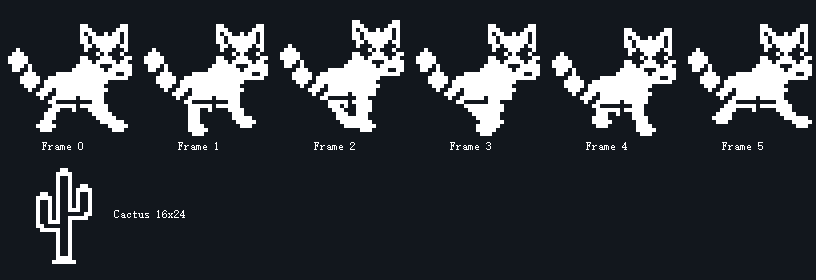

# OLED 小熊猫奔跑与仙人掌

素材已加入 `bsp/OLED_Data.c`，包含向右奔跑的小熊猫 6 帧（32×32，每帧 128 字节）和一个仙人掌（16×24，48 字节）。图像共占 816 字节常量空间，使用现有驱动的纵向 8 点格式，低位对应上方像素。



包含 `OLED.h` 即可绘制，坐标表示位图左上角：

```c
OLED_Clear();
OLED_ShowPandaRun(8, 24, 0); /* 帧号 0~5，超出后自动取模 */
OLED_ShowCactus(96, 32);
OLED_DrawLine(0, 56, 127, 56);
OLED_Update();
```

也可以直接调用原有接口：

```c
OLED_ShowImage(8, 24, OLED_PANDA_WIDTH, OLED_PANDA_HEIGHT, Panda_Run[0]);
OLED_ShowImage(96, 32, OLED_CACTUS_WIDTH, OLED_CACTUS_HEIGHT, Cactus);
```

下面是供独立演示使用的非阻塞刷新函数。OLED 初始化后，在主循环中反复调用它即可看到奔跑和向左移动的障碍物。每 80 ms 绘制一帧，完整动作周期为 480 ms；小熊猫内部已经包含上下起伏，无需额外调整 Y 坐标。

```c
#include "main.h"
#include "OLED.h"

void Panda_DemoUpdate(void)
{
    static uint32_t lastTick = 0;
    static uint8_t frame = 0;
    static int16_t cactusX = 128;
    uint32_t now = HAL_GetTick();

    if ((uint32_t)(now - lastTick) < OLED_PANDA_FRAME_MS)
    {
        return;
    }
    lastTick = now;

    OLED_Clear();
    OLED_ShowPandaRun(8, 24, frame);
    OLED_ShowCactus(cactusX, 32);
    OLED_DrawLine(0, 56, 127, 56);
    OLED_Update();

    frame = (uint8_t)((frame + 1U) % OLED_PANDA_RUN_FRAMES);
    cactusX -= 4;
    if (cactusX <= -(int16_t)OLED_CACTUS_WIDTH)
    {
        cactusX = 128;
    }
}
```

此示例只演示动画，不包含跳跃和碰撞处理。项目原有 `App_Run()` 内有页面循环，接入具体页面时应在该页面循环中调用动画刷新函数，并让同一页面统一负责绘制和刷新，避免两个界面相互覆盖。

两个显示函数仅修改显存，最后需要调用 `OLED_Update()`。移动精灵时清除旧位置；示例每帧清屏重绘，因此不会残留拖影。各精灵的矩形区域不要重叠，现有 `OLED_ShowImage()` 会先清除目标矩形，再写入图像。

## 当前游戏页面的刷新方式

`bsp/game_page.c` 的 `GamePage_Run()` 已采用局部刷新：进入页面时完整绘制一次地面和精灵，之后只发送熊猫和仙人掌旧、新位置覆盖的区域。传输前会裁剪屏幕边界；障碍物从左侧回到右侧时分别处理两端，避免刷新中间整段。暂停期间不重复写屏。

游戏运动每40ms推进一步，目标为25帧/秒；障碍物每步向左移动3像素，达到5分后增至4像素，达到10分后增至5像素。熊猫跑动素材每80ms切换一帧。跳跃使用1/16像素定点位置和速度，按固定步长更新，不再取决于页面循环速度。一次循环最多补算4步，避免外设长时间阻塞后持续追赶；更长的停顿会丢弃多余运动步数。暂停恢复时重新对齐时基，不补算暂停期间的运动。

I²C仍保持项目原有100kHz。完整1024字节显存仅数据及ACK就需要约92ms，局部刷新能大幅缩短阻塞时间；实际帧率还受绘图和传输开销影响，需要板上验证。按键仍沿用松手触发，因此跳跃在按键释放后发生。

## 游戏规则与操作

游戏逻辑在 `bsp/game.c`、`bsp/game.h`，页面绘制和计时循环在 `bsp/game_page.c`，由 `menu_page.c` 调用。地面位于Y=62，熊猫站立位置为(0,30)，仙人掌位置为(cactusX,38)，素材尺寸仍分别为32×32和16×24。

| 状态 | 按键1 | 按键2 | 按键3 |
|---|---|---|---|
| 运行 | 落地后跳跃，空中不能再次起跳 | 暂停 | 返回菜单 |
| 暂停 | 无操作 | 继续 | 返回菜单 |
| 结束 | 新开一局 | 无操作 | 返回菜单 |

顶部 `S` 为本局分数，`HI` 为最高分。每越过一个障碍物加1分，分数上限9999；障碍物从左侧消失后，在右侧按三种间距循环出现。最高分在重新开始和返回菜单后保留，复位或断电后清零；每次进入游戏都新开一局。

碰撞只判断双方内缩范围中实际点亮的像素，允许尾巴、脚尖和障碍物边缘擦过：熊猫取素材内X=6～25、Y=4～27的20×24区域；仙人掌取X=3～12、Y=2～21的10×20区域。图片显示尺寸保持32×32和16×24。可在 `bsp/game.h` 调整 `GAME_PANDA_HIT_*`、`GAME_CACTUS_HIT_*`，其中RIGHT和BOTTOM表示不包含的右、下边界。比较时按位图纵向列对齐，逐列做位运算，避免每帧逐个检查整块像素。每一个补算的运动步都会检查碰撞，发生碰撞后立即停止该局，显示 `OVER 1:RETRY`。

精灵重叠时使用点亮像素叠加绘制，避免仙人掌的透明区域擦掉熊猫。跳跃经过顶部显存页时会恢复分数栏，暂停和结束仅在状态变化时完整刷新一次。

## 验证

在项目根目录运行 `./tests/run_game_tests.ps1`，需要可从PATH调用的GCC。测试使用实际素材和游戏逻辑，并从当前源文件提取OLED及页面绘图函数，替换硬件传输与毫秒时基。

- 碰撞结果与独立逐像素算法逐项比较，覆盖所有动画帧及多组位置，确认边缘接触被放宽、主体碰撞保留，并且不会新增原先不存在的碰撞。
- 验证禁止二段跳、落地、暂停、结束、重新开始、分数上限和三档速度，并模拟连续越过20个障碍物。
- 每次页面循环将局部刷新的显存、模拟屏幕与完整重绘逐字节比较，覆盖跳跃顶点、精灵重叠、分数变化、障碍物重生、暂停恢复、重新开始、时基回绕和传输延迟。

当前整工程已用Keil Arm Compiler 5.06编译、链接并生成HEX，保留原有设置页及秒表的4条编译警告。为了满足当前Keil的32KB链接限制，菜单素材中未使用的第8个空白填充图标已移除，实际7个菜单图标保持原样。模拟测试通过；按键手感、实际刷新速度和屏幕效果仍需下载到开发板验收。
